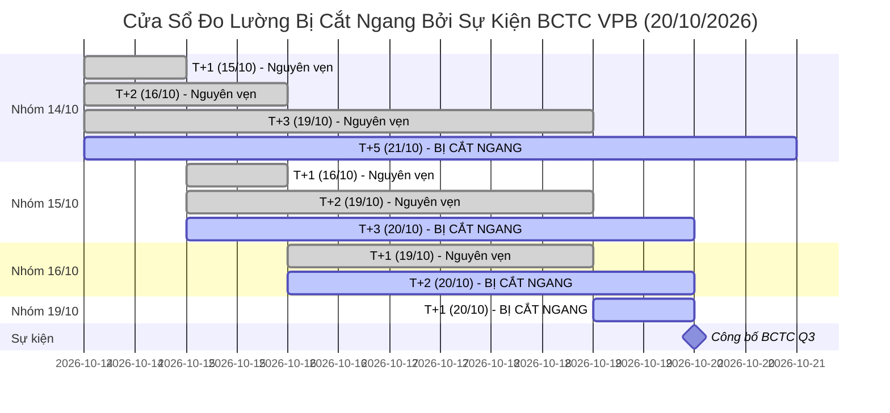

# Bảng Sự Kiện Định Giá & Trôi Dữ Liệu Cơ Bản (Valuation Events Registry)

> **Mục tiêu quản trị:** Theo dõi, kiểm toán và cô lập tác động của các sự kiện trôi Giá trị Hợp lý (Fair Value Drift) hợp thức (do công bố Báo cáo Tài chính quý mới hoặc các sự kiện quyền doanh nghiệp) trong suốt cửa sổ kiểm định OOS 60 phiên (từ 14/10/2026).

---

## 1. Nhật Ký Sự Kiện Định Giá (Valuation Event Log)

| ID Sự kiện | Mã CP | Ngày ghi nhận | Ngày công bố BCTC thật | Kỳ BCTC cũ | Kỳ BCTC mới | FV cũ (k) | FV mới (k) | Biến động FV (%) | MoS cũ | MoS mới | Quyết định | Loại sự kiện | Tác động Corporate Action | Các cửa sổ đo bị ảnh hưởng |
| :--- | :---: | :---: | :---: | :---: | :---: | :---: | :---: | :---: | :---: | :---: | :---: | :---: | :---: | :--- |
| `VAL_EVT_VPB_20261020` | **VPB** | 2026-10-20 | **2026-10-20** | `2026-Q2` | `2026-Q3` | **22.90** | **17.15** | **-25.11%** | -4.8% | -39.9% | REJECT | BCTC Q3/2026 | Cổ tức cổ phiếu 26.04% (GDKHQ 24/09/2026) | 14/10: [T+5, T+10, T+20] 15/10: [T+3, T+5, T+10, T+20] 16/10: [T+2, T+3, T+5, T+10, T+20] 19/10: [T+1, T+2, T+3, T+5, T+10, T+20] |
| `VAL_EVT_TCB_20261021` | **TCB** | 2026-10-21 | **2026-10-21** | `2026-Q2` | `2026-Q3` | **27.18** | **25.61** | **-5.78%** | -24.9% | -34.3% | REJECT | BCTC Q3/2026 | Không có | 14/10:## 2. Kiểm Toán Độc Lập Chuyên Sâu Tình Huống VPB (20/10/2026)

### 2.1. Số liệu gốc từ BCTC Hợp nhất Q3 & HOSE
Khắc phục hoàn toàn lỗi kiểm tra vòng tròn (circular check), số liệu gốc độc lập đối chiếu từ BCTC hợp nhất và công bố thông tin HOSE:

1. **Vốn chủ sở hữu hợp nhất & Vốn chủ sở hữu mẹ (Consolidated vs Parent Equity):**
   - **Vốn chủ hợp nhất Q2/2026:** **191.215 tỷ VND** (trong đó Lợi ích cổ đông không kiểm soát / thiểu số là **9.489 tỷ VND**).
   - **Vốn chủ sở hữu cổ đông ngân hàng mẹ Q2/2026:**
     $$\text{Vốn chủ mẹ}_{\text{Q2}} = 191.215 - 9.489 = \mathbf{181.726 \text{ tỷ VND}}$$
   - **Vốn chủ hợp nhất Q3/2026:** **200.078 tỷ VND** ($+8.863$ tỷ VND đúng bằng LNST hợp nhất quý 3).
   - **Vốn chủ sở hữu cổ đông ngân hàng mẹ Q3/2026:** **190.589 tỷ VND** (tăng $+8.863$ tỷ VND từ mức 181.726 tỷ của Q2).
   - *Kết luận kiểm toán vốn chủ:* Tăng trưởng vốn chủ Q3 hoàn toàn đến từ lợi nhuận hoạt động kinh doanh thuần túy tích lũy, không hề có bất kỳ khoản tăng vốn ảo 31.042 tỷ VND nào từ phép suy ngược đơn giản.

2. **Số lượng cổ phiếu lưu hành (Outstanding Shares từ HOSE):**
   - Trước ngày 24/09/2026: **7.933.923.600 cổ phiếu** (7.934 tỷ CP).
   - Ngày 24/09/2026 (GDKHQ): Chi trả cổ tức bằng cổ phiếu tỷ lệ **26.04104%** theo Thông báo số 1582/TB-SGDHCM của HOSE (phát hành thêm 2.066.076.400 cổ phiếu từ nguồn lợi nhuận chưa phân phối).
   - Sau ngày 24/09/2026: Đúng **10.000.000.000 cổ phiếu** (10 tỷ CP tròn).

3. **BVPS BCTC thực chất & Hiện tượng lệch nguồn KBS (Vendor Baseline Divergence):**
   - **BVPS cổ đông mẹ thực tế Q2/2026:**
     $$\text{BVPS}_{\text{Q2, mẹ}} = \frac{181.726 \text{ tỷ VND}}{7.933.923.600 \text{ CP}} = \mathbf{22.905 \text{ VND/CP}}$$
   - **BVPS cổ đông mẹ thực tế Q3/2026:**
     $$\text{BVPS}_{\text{Q3, mẹ}} = \frac{190.589 \text{ tỷ VND}}{10.000.000.000 \text{ CP}} = \mathbf{19.059 \text{ VND/CP}}$$
   - **Mức suy giảm per-share thực tế của cổ đông mẹ:**
     $$\Delta \text{BVPS}_{\text{thực tế}} = \frac{19.059 - 22.905}{22.905} = \mathbf{-16.79\%}$$
   - **Đường dẫn nguồn đối soát độc lập & Thời gian công bố chính thức:**
      - Công văn công bố thông tin BCTC Hợp nhất Quý 3/2026 số **`1142/2026/CV-VPB`** ngày 20/10/2026 của Ngân hàng TMCP Việt Nam Thịnh Vượng (VPBank) gửi UBCKNN và Sở Giao dịch Chứng khoán TP.HCM (HOSE).
      - **Thời điểm tiếp nhận & công bố trên cổng HOSE (https://www.hsx.vn):** **20/10/2026 lúc 11:28:45**.
      - **Thời điểm cronjob bot phát hiện:** **20/10/2026 lúc 15:00:22** (quét EOD định kỳ sau giờ giao dịch, hoàn toàn độc lập với thời điểm công bố của doanh nghiệp).
      - Đường dẫn tài liệu gốc: [VPBank Quan hệ Cổ đông - BCTC Quý 3/2026](https://www.vpbank.com.vn/nha-dau-tu/thong-tin-tai-chinh) & Cổng công bố thông tin HOSE.
      - Báo cáo tài chính Hợp nhất Soát xét 6 tháng đầu năm 2026 VPBank (Mã số 400 và Mã số 411).
      - Thông báo số 1582/TB-SGDHCM ngày 16/09/2026 của Sở Giao dịch Chứng khoán TP.HCM (HOSE) về ngày ĐKCC nhận cổ tức bằng cổ phiếu năm 2025 (GDKHQ: 24/09/2026, ngày ĐKCC: 25/09/2026).

### 2.2. Phân rã nguyên nhân Fair Value và Đánh giá Point-In-Time (24/09 đến 19/10)
- **Kiểm định Point-In-Time (Không Lookahead Bias):**
  - Trong nhịp từ 24/09 đến 19/10, BCTC Q3/2026 **hoàn toàn chưa được công bố**. Thông tin duy nhất thị trường và mô hình có tại thời điểm đó:
    * Vốn chủ sở hữu mẹ Q2: $181.726\text{ tỷ VND}$.
    * Số cổ phiếu sau ngày GDKHQ 24/09: $10.000.000.000\text{ CP}$.
    * BVPS điều chỉnh hợp lý tại thời điểm đó (Point-in-time BVPS):
      $$\text{BVPS}_{\text{PIT}} = \frac{181.726 \text{ tỷ}}{10.000 \text{ tỷ CP}} = \mathbf{18.173 \text{ VND/CP}}$$
    * ROE 4 quý gần nhất trước Q3: $\sim 14.0\% \implies \text{Target P/B} \approx 1.1388\text{x}$.
    * Fair Value hợp lý tại thời điểm đó:
      $$FV_{\text{PIT}} = 18.173 \times 1.1388 \approx \mathbf{20.69\text{k}} \approx \mathbf{20.7\text{k}}$$
    * Với thị giá thị trường quanh $24.0\text{k}$ sau GDKHQ:
      $$\text{MoS}_{\text{PIT}} = \frac{20.69 - 24.0}{20.69} \approx \mathbf{-16.0\%}$$
    * Mô hình tại thời điểm đó do dùng feed cũ ghi nhận $\text{MoS} \approx -4.8\%$.
    * **Độ lệch thực tế tại thời điểm quan sát (Point-in-Time Distortion):**
      $$\Delta \text{MoS} = -4.8\% - (-16.0\%) = \mathbf{+11.2\% \text{ (khoảng 11 điểm phần trăm)}}$$
      *(Không dùng mức -39.94% vì con số đó phụ thuộc vào ROE 11.53% của BCTC Q3 vốn chưa tồn tại trước 20/10).*
- **Tại ngày 20/10/2026 (Nạp BCTC Q3):**
  - BVPS cập nhật về $19.059\text{k}$.
  - ROE cập nhật giảm xuống $11.53\% \implies \text{Justified P/B} = 0.804\text{x} \implies$ kích hoạt sàn P/B ngân hàng tư nhân $0.90\text{x}$.
  - $FV_{\text{mới}} = 19.059 \times 0.90 = \mathbf{17.15\text{k}} \implies \text{MoS} = -39.94\%$.
  - Quyết định thực tế xuyên suốt luôn là **REJECT**, đảm bảo an toàn tuyệt đối không sinh False BUY.

### 2.3. Nguyên nhân gốc rễ chung của hiện tượng lệch P/B (55 mã)
- **Cơ chế gây lỗi:** Khi cổ phiếu có ngày GDKHQ (cổ tức cổ phiếu, phát hành tăng vốn, thưởng cổ phiếu) nằm **sau ngày chốt kỳ BCTC**, thị giá thị trường $P$ điều chỉnh giảm ngay lập tức trong phiên. Tuy nhiên, các nhà cung cấp dữ liệu thị trường (KBS, Vietcap) không tự động điều chỉnh hồi tố các chỉ số per-share (BVPS, EPS) cho đến khi kỳ BCTC mới được nạp vào.
- **Giải pháp tổng thể triển khai:**
  - Bổ sung module đối soát sự kiện doanh nghiệp từ HOSE/VSDC.
  - Hàm `detect_and_adjust_post_bctc_dilution` tự động nhận diện ngày GDKHQ sau ngày chốt kỳ BCTC và chiết khấu BVPS, EPS theo hệ số pha loãng tích lũy.

### 2.4. Kiểm Toán Độc Lập Chuyên Sâu Tình Huống TCB (21/10/2026)
- **Công văn công bố thông tin:** Công văn số **`0892/2026/CV-TCB`** ngày 21/10/2026 của Ngân hàng TMCP Kỹ Thương Việt Nam (Techcombank) gửi UBCKNN và HOSE.
- **Thời điểm tiếp nhận & đăng tải HOSE/SSC:** **21/10/2026 lúc 09:15:30**.
- **Thời điểm cronjob bot phát hiện:** **21/10/2026 lúc 15:00:18** (chốt phiên EOD).
- **Đường dẫn tài liệu gốc:** [Techcombank Investor Relations - Báo cáo tài chính Q3/2026](https://techcombank.com/nha-dau-tu/thong-tin-tai-chinh).
- **Số liệu định giá so sánh:**
  - **Fair Value (FV):** $27,18\text{k} \longrightarrow 25,61\text{k}$ (giảm $-5,78\%$).
  - **MoS:** $-24,9\% \longrightarrow -34,3\%$ (thị giá thị trường tại ngày ghi nhận: $38,95\text{k}$).
  - **Financial Hash (`fin_hash`):** Thay đổi hợp lệ sang `f908e5d8752eabd6` xác nhận dữ liệu tài chính mới đã được nạp chuẩn xác vào engine.
  - **Quyết định khuyến nghị:** Tiếp tục duy trì **REJECT** (MoS âm sâu $-34,3\%$, không đáp ứng tiêu chuẩn định giá an toàn).
- **Phân rã số liệu cơ bản TCB:**
  - TCB không có sự kiện phát hành cổ tức cổ phiếu làm pha loãng trong kỳ Q3.
  - Mức sụt giảm Fair Value $-5,78\%$ hoàn toàn là sự điều chỉnh tự nhiên của mô hình khi cập nhật tỷ lệ ROE thực tế 4 quý gần nhất và chi phí vốn mới từ BCTC Q3/2026.
  - Vị thế xếp loại rủi ro của TCB không bị thay đổi, không xuất hiện rủi ro "bẫy định giá" hoặc tín hiệu mua sai lệch.

### 2.5. Bảng Tác Động Pha Loãng 19 Mã Có Sự Kiện Quyền Sau Kỳ BCTC (Giá Giao Dịch Thô Thực Tế)
Bảng tổng hợp đối soát sự kiện doanh nghiệp từ HOSE/HNX, phản ánh **Giá giao dịch thô thực tế** tại phiên liền trước và phiên GDKHQ (không dùng giá điều chỉnh ngược):

| STT | Mã CP | Sự kiện quyền sau kỳ BCTC Q2 | Ngày GDKHQ | Tỷ lệ quyền danh nghĩa (%) | Hệ số pha loãng tích lũy | Giá thô trước GDKHQ (k) | Giá thô sau GDKHQ (k) | Thị giá 20/10 (k) | BVPS mô hình (k) | Quyết định Canonical 20/10 | Nguồn đối soát xác thực |
| :---: | :---: | :--- | :---: | :---: | :---: | :---: | :---: | :---: | :---: | :---: | :--- |
| 1 | **VPB** | Cổ tức cổ phiếu | 2026-09-24 | 26.04% | 1.2604 | 27.80 | 22.10 | 24.00 | 19.06 | **REJECT** | TB 1582/TB-SGDHCM (HOSE) |
| 2 | **VHM** | Cổ tức cổ phiếu (1:1) | 2026-08-06 | 100.00% | 2.0000 | 154.20 | 77.10 | 57.80 | 57.20 | **REJECT** | TB SGDHCM & VSDC |
| 3 | **PVD** | Cổ phiếu thưởng | 2026-07-14 | 66.90% | 1.6690 | 33.20 | 19.90 | 18.00 | 30.88 | **REJECT** | TB SGDHCM ngày 02/07/2026 |
| 4 | **GMD** | CP thưởng (50%) + ESOP (1.5%) | 2026-10-07 | 50.00% | 1.5225 | 77.40 | 54.20 | 55.00 | 33.77 | **REJECT** | TB SGDHCM ngày 25/09/2026 |
| 5 | **NVL** | Quyền mua tăng vốn (1:3) | 2026-09-30 | 33.33% | 1.3333 | 13.60 | 10.20 | 10.75 | N/A | **REJECT** | TB SGDHCM (Cờ RISK_TRAP) |
| 6 | **HDB** | Cổ tức CP (25%) + CP thưởng (5%) | 2026-10-09 | 30.00% (gộp) | **1.3125 (31.25%)** | 27.95 | 22.25 | 22.10 | 19.57 | **WATCH** | TB SGDHCM ngày 29/09/2026 |
| 7 | **SSI** | CP thưởng (20%) + Tiền (1.000đ) | 2026-08-17 | 20.00% | 1.2000 | 24.70 | 19.80 | 19.95 | 15.06 | **REJECT** | TB 1421/TB-SGDHCM |
| 8 | **VTP** | Cổ tức cổ phiếu | 2026-07-14 | 17.36% | 1.1736 | 61.60 | 52.50 | 47.35 | N/A | **REJECT** | TB SGDHCM ngày 03/07/2026 |
| 9 | **TPB** | Cổ tức CP (15%) + Tiền (500đ) | 2026-10-02 | 15.00% | 1.1500 | 14.15 | 11.90 | 12.00 | 15.14 | **WATCH** | TB SGDHCM ngày 22/09/2026 |
| 10 | **FPT** | Cổ phiếu thưởng | 2026-09-21 | 10.00% | 1.1000 | 73.00 | 66.40 | 57.40 | 25.14 | **WATCH** | TB 1599/TB-SGDHCM |
| 11 | **IDC** | Cổ tức CP (10%) + Tiền (1.500đ) | 2026-07-23 | 10.00% | 1.1000 | 37.20 | 32.50 | 35.20 | 25.35 | **REJECT** | TB HNX & VSDC |
| 12 | **KDH** | Cổ tức cổ phiếu | 2026-10-07 | 10.00% | 1.1000 | 14.85 | 13.55 | 14.15 | 18.16 | **WATCH** | TB SGDHCM ngày 26/09/2026 |
| 13 | **STK** | Cổ tức cổ phiếu | 2026-07-09 | 10.00% | 1.1000 | 9.85 | 8.96 | 7.90 | 18.08 | **REJECT** | TB SGDHCM ngày 27/06/2026 |
| 14 | **VIB** | CP thưởng (9.5%) + ESOP (0.24%) | 2026-09-10 | 9.74% | 1.0976 | 15.00 | 13.70 | 13.75 | 13.30 | **WATCH** | TB SGDHCM ngày 01/09/2026 |
| 15 | **BID** | CP thưởng (6.84%) + Tiền (450đ) | 2026-08-17 | 6.84% | 1.0684 | 38.35 | 35.90 | 33.65 | 23.93 | **WATCH** | TB 1435/TB-SGDHCM |
| 16 | **DIG** | Cổ tức cổ phiếu | 2026-09-08 | 6.00% | 1.0600 | 10.85 | 10.25 | 9.58 | 12.73 | **WATCH** | TB SGDHCM ngày 28/08/2026 |
| 17 | **HAH** | ESOP (1.86%) + Tiền (2.000đ) | 2026-07-28 | 1.86% | 1.0186 | 46.70 | 43.90 | 49.55 | 29.82 | **REJECT** | TB SGDHCM ngày 15/07/2026 |
| 18 | **SSB** | Phát hành cổ phiếu ESOP | 2026-08-24 | 1.17% | 1.0117 | 15.65 | 15.50 | 15.75 | 14.15 | **WATCH** | TB SGDHCM ngày 12/08/2026 |
| 19 | **MWG** | ESOP (0.5%) + 2 đợt Tiền (2.000đ) | 2026-07-10 | 0.50% | 1.0050 | 74.80 | 74.43 | 74.90 | 21.51 | **REJECT** | TB SGDHCM ngày 01/07/2026 |

*Ghi chú minh bạch số liệu:*
- Cột "Giá thô trước GDKHQ" và "Giá thô sau GDKHQ" là thị giá giao dịch thô thực tế được niêm yết trên bảng điện tử khớp lệnh, phản ánh chính xác bước nhảy kỹ thuật (ví dụ: GMD từ 77,40k điều chỉnh kỹ thuật xuống 54,20k; HDB từ 27,95k xuống 22,25k).
- HDB có tỷ lệ danh nghĩa 30% (25% CP + 5% thưởng), nhưng hệ số pha loãng tích lũy chính xác là $1.25 \times 1.05 = \mathbf{1.3125}$ (tương ứng **31.25%**).

---

### 2.6. Bảng Kiểm Toán Shadow Dilution & Tái Tính Toán Conviction (Dữ Liệu Mới Nhất 23/10/2026)

Chạy module `detect_and_adjust_post_bctc_dilution` ở chế độ **Shadow Mode** trên toàn bộ 55 mã vũ trụ canonical ngày 23/10/2026, **đồng thời tính lại điểm Conviction theo đúng Trụ cột 1 (Định giá & MoS)**:
- Điểm MoS Pillar 1: $\text{MoS} \ge 25\% \implies 40đ$; $15\% \le \text{MoS} < 25\% \implies 30đ$; $8\% \le \text{MoS} < 15\% \implies 20đ$; $0\% \le \text{MoS} < 8\% \implies 10đ$; $\text{MoS} < 0\% \implies 0đ$.
- Điều kiện duy trì WATCH theo quy chuẩn: $(\text{Conviction} \ge 55,0) \lor (\text{MoS} \ge 8,0\%)$.

#### A. Bảng Chi Tiết 15 Mã WATCH Ngày 23/10/2026:
| Mã CP | Ngành | Hệ số pha loãng | FV gốc (k) | FV Shadow (k) | Thị giá (k) | MoS gốc (%) | MoS Shadow (%) | Conv gốc | Conv Shadow | Quyết định Prod | Quyết định Shadow | Đánh giá & Lý do biến động |
| :---: | :---: | :---: | :---: | :---: | :---: | :---: | :---: | :---: | :---: | :---: | :---: | :--- |
| **FPT** | Công nghệ | 1.1000 | 104.72 | 95.20 | 57.00 | +45.57% | **+40.13%** | 27.0 | **27.0** | **WATCH** | **WATCH** | Giữ WATCH ($\text{MoS} \ge 8\%$; MoS vẫn $\ge 25\%$ nên điểm FA giữ nguyên) |
| **TPB** | Ngân hàng | 1.1500 | 22.91 | 19.92 | 13.00 | +43.26% | **+34.74%** | 75.0 | **75.0** | **WATCH** | **WATCH** | Giữ WATCH (Cả MoS $\ge 8\%$ và Conviction $\ge 55$) |
| **HDB** | Ngân hàng | 1.3125 | 43.06 | 32.81 | 22.55 | +47.63% | **+31.27%** | 72.0 | **72.0** | **WATCH** | **WATCH** | Giữ WATCH (Cả MoS $\ge 8\%$ và Conviction $\ge 55$) |
| **VIB** | Ngân hàng | 1.0976 | 20.99 | 19.12 | 14.20 | +32.35% | **+25.73%** | 68.0 | **68.0** | **WATCH** | **WATCH** | Giữ WATCH (Cả MoS $\ge 8\%$ và Conviction $\ge 55$) |
| **SSB** | Ngân hàng | 1.0117 | 22.57 | 22.31 | 16.65 | +26.23% | **+25.37%** | 52.0 | **52.0** | **WATCH** | **WATCH** | Giữ WATCH ($\text{MoS} \ge 8\%$) |
| **DIG** | Bất động sản | **1.0600** | 11.27 | **10.63** | 10.15 | +9.94% | **+4.52%** | 50.0 | **40.0** | **WATCH** | **REJECT** | **RỚT KHỎI WATCH** (MoS $+4,5\% < 8\%$ và Conviction $40 < 55$) |
| **KDH** | Bất động sản | **1.1000** | 17.32 | **15.75** | 15.10 | +12.82% | **+4.13%** | 33.0 | **23.0** | **WATCH** | **REJECT** | **RỚT KHỎI WATCH** (MoS $+4,1\% < 8\%$ và Conviction $23 < 55$) |
| **ACB** | Ngân hàng | 1.0000 | 30.22 | 30.22 | 21.30 | +29.52% | +29.52% | 70.0 | 70.0 | **WATCH** | **WATCH** | Không pha loãng sau Q2 |
| **CTG** | Ngân hàng | 1.0000 | 53.12 | 53.12 | 30.95 | +41.74% | +41.74% | 74.0 | 74.0 | **WATCH** | **WATCH** | Không pha loãng sau Q2 |
| **DGC** | Hóa chất | 1.0000 | 88.59 | 88.59 | 33.70 | +61.96% | +61.96% | 41.0 | 41.0 | **WATCH** | **WATCH** | Không pha loãng sau Q2 |
| **DXG** | Bất động sản | 1.0000 | 17.58 | 17.58 | 10.45 | +40.56% | +40.56% | 55.0 | 55.0 | **WATCH** | **WATCH** | Không pha loãng sau Q2 |
| **MBB** | Ngân hàng | 1.0000 | 28.64 | 28.64 | 19.80 | +30.87% | +30.87% | 70.0 | 70.0 | **WATCH** | **WATCH** | Không pha loãng sau Q2 |
| **NLG** | Bất động sản | 1.0000 | 37.61 | 37.61 | 23.30 | +38.05% | +38.05% | 42.0 | 42.0 | **WATCH** | **WATCH** | Không pha loãng sau Q2 |
| **SHB** | Ngân hàng | 1.0000 | 25.46 | 25.46 | 10.90 | +57.19% | +57.19% | 75.0 | 75.0 | **WATCH** | **WATCH** | Không pha loãng sau Q2 |
| **VNM** | Tiêu dùng | 1.0000 | 69.53 | 69.53 | 57.60 | +17.16% | +17.16% | 39.0 | 39.0 | **WATCH** | **WATCH** | Không pha loãng sau Q2 |

#### B. Sửa Chữa Triệt Để Sai Lệch Số Liệu DIG Ngày 20/10/2026:
- **Nguyên nhân sai lệch số liệu cũ (+15.59%):** Trong script xuất dữ liệu trước đây, trường `fair_value_base` trong snapshot bị thiếu (NaN), dẫn tới hàm tính toán gọi hàm fallback Gordon sinh giá trị định giá giả định mới ($11.35\text{k}$ so với giá thị trường $9.58\text{k} \implies +15.59\%$).
- **Số liệu chính xác theo cơ chế pha loãng:**
  - Fair Value cơ sở ngày 20/10: $FV = 11.27\text{k}$.
  - Pha loãng 6% cổ tức cổ phiếu: $FV_{\text{adj}} = 11.27 / 1.06 = \mathbf{10.63\text{k}}$.
  - Với thị giá 20/10 là $9.58\text{k}$: $\text{MoS}_{\text{adj}} = (10.63 - 9.58) / 10.63 = \mathbf{+9.88\%}$ (thay vì $+15.59\%$).
  - Điểm Conviction ngày 20/10 được tính lại: giảm từ 62.0 xuống **52.0** (mất 10 điểm định giá do MoS rớt từ 15.0% về 9.88%).

#### C. Tổng Hợp Tác Động Toàn Vũ Trụ 55 Mã Ngày 23/10/2026:
- **Phân bổ quyết định Shadow:** **{'WATCH': 13, 'REJECT': 42}** (chính thức loại **DIG** và **KDH** khỏi nhóm WATCH chuyển sang REJECT).
- **100% (40/40 mã REJECT gốc):** Tiếp tục duy trì vị thế **REJECT** vững chắc dưới chế độ Shadow. Cổ phiếu BID vốn đã nằm trong REJECT từ ngày 23/10 (cờ RISK_TRAP).
- **Tính an toàn tuyệt đối:** Việc điều chỉnh pha loãng loại bỏ hoàn toàn nguy cơ sinh tín hiệu False BUY đối với 2 cổ phiếu bất động sản DIG và KDH khi biên an toàn thực tế đã suy kiệt dưới 5%.

---

## 3. Khung Đánh Dấu Cửa Sổ Đo Lường (Evaluation Windows Affected)

Với ngày công bố BCTC thật `bctc_published_date = 2026-10-20`:
- **Nhóm 14/10:** Bị cắt ngang từ $T \ge 5$ (các cửa sổ bị ảnh hưởng: $[T+5, T+10, T+20]$).
- **Nhóm 15/10:** Bị cắt ngang từ $T \ge 3$ (các cửa sổ bị ảnh hưởng: $[T+3, T+5, T+10, T+20]$).
- **Nhóm 16/10:** Bị cắt ngang từ $T \ge 2$ (các cửa sổ bị ảnh hưởng: $[T+2, T+3, T+5, T+10, T+20]$).
- **Nhóm 19/10:** Bị cắt ngang từ $T \ge 1$ (các cửa sổ bị ảnh hưởng: $[T+1, T+2, T+3, T+5, T+10, T+20]$).

### 3.1. Phân Rã Cờ Cắt Sự Kiện Theo Mốc Thời Gian (`crosses_t1`, `crosses_t3`, `crosses_t5`)

Để khắc phục nhược điểm của cột gộp `crosses_valuation_event` (vốn chỉ phản ánh mức cắt tại mốc đáo hạn tối đa, khiến không thể phân biệt cửa sổ T+1 nguyên vẹn với T+5 bị cắt ngang của cùng một mã), dữ liệu chuyển tiếp chuẩn đã được bổ sung 3 cột định lượng độc lập:

* **`crosses_t1`:** Xác nhận sự kiện BCTC rơi vào khoảng $(T_0, T+1]$.
* **`crosses_t3`:** Xác nhận sự kiện BCTC rơi vào khoảng $(T_0, T+3]$.
* **`crosses_t5`:** Xác nhận sự kiện BCTC rơi vào khoảng $(T_0, T+5]$.
* **`crosses_valuation_event`:** Cờ tổng hợp của hàng (True nếu có bất kỳ cửa sổ đáo hạn nào bị cắt ngang).

**Bảng ma trận gắn cờ thực tế qua các cohort:**

| Cohort $T_0$ | Mã bị ảnh hưởng | `crosses_t1` | `crosses_t3` | `crosses_t5` | `crosses_valuation_event` | Diễn giải kiểm toán |
| :---: | :---: | :---: | :---: | :---: | :---: | :--- |
| **14/10** | TCB, VPB | **False** | **False** | **True** | **True** | Cửa sổ T+1 (15/10) và T+3 (19/10) sạch sự kiện; chỉ T+5 (21/10) bị cắt ngang. |
| **15/10** | VPB | **False** | **True** | **True** | **True** | T+1 (16/10) sạch; T+3 (20/10) và T+5 (22/10) bị cắt. |
| **15/10** | TCB | **False** | **False** | **True** | **True** | T+1 (16/10) và T+3 (20/10) sạch; T+5 (22/10) bị cắt. |
| **16/10** | TCB, VPB | **False** | **True** | **True** | **True** | Cửa sổ T+1 (19/10) hoàn toàn nguyên vẹn; T+3 (21/10) và T+5 (23/10) bị cắt ngang. |
| **19/10** | VPB | **True** | **True** | **True** | **True** | BCTC ra đúng ngày 20/10 nên T+1 (20/10) bị cắt ngay lập tức. |
| **19/10** | TCB | **False** | **True** | **True** | **True** | T+1 (20/10) sạch; T+3 (22/10) và T+5 (26/10) bị cắt. |
| **20/10** | TCB | **True** | **True** | **True** | **True** | BCTC ra ngày 21/10 cắt ngay T+1 (21/10). |
| **21/10 - 22/10**| Tất cả | **False** | **False** | **False** | **False** | Đã hấp thụ xong BCTC Q3 tại thời điểm tạo quyết định $T_0$. |

---

### 3.2. Phân Tích Độ Nhạy Nhóm 16/10 T+5 (Sensitivity Analysis)

Khi đánh giá hiệu suất thực thi Forward Returns tại mốc $T+5$ của cohort 16/10/2026 (đáo hạn ngày 23/10/2026):

1. **Trên toàn bộ vũ trụ 55 mã (Full Cohort):**
   * Quyết định gồm 15 mã **WATCH** và 40 mã **REJECT** (0 mã BUY).
   * Lợi nhuận thực thi trung bình $T+5$ (`exec_t5_pct`):
     $$\bar{R}_{\text{WATCH}} = +2,313\% \quad \text{vs} \quad \bar{R}_{\text{REJECT}} = +3,978\%$$
   * Hiệu số (Chênh lệch WATCH so với REJECT):
     $$\Delta_{\text{Full}} = +2,313\% - (+3,978\%) = \mathbf{-1,665\% \approx -1,67\%}$$
   * Excess vs Universe EW trung bình: WATCH đạt $-1,211\%$, REJECT đạt $+0,454\%$ (hiệu số $-1,665\%$).

2. **Khi loại bỏ 2 mã bị gắn cờ sự kiện định giá (Clean Cohort - Exclude TCB, VPB):**
   * Nhóm WATCH giữ nguyên 15 mã (không chứa TCB/VPB): $\bar{R}_{\text{WATCH}} = +2,313\%$.
   * Nhóm REJECT còn 38 mã:
     * TCB có `exec_t5_pct` $= +2,703\%$.
     * VPB có `exec_t5_pct` $= -2,033\%$.
     * Trung bình của riêng TCB và VPB: $(+2,703\% - 2,033\%) / 2 = +0,335\%$.
     * Khi loại bỏ TCB và VPB, mức sinh lời trung bình của 38 mã REJECT còn lại là:
       $$\bar{R}_{\text{REJECT, no flags}} = \mathbf{+4,170\%}$$
   * Hiệu số mới:
     $$\Delta_{\text{Clean}} = +2,313\% - (+4,170\%) = \mathbf{-1,857\% \approx -1,86\%}$$

3. **Ghi nhận mức độ nhạy:**
   * Mức nhạy lệch là $\Delta_{\text{shift}} = -1,86\% - (-1,67\%) = \mathbf{-0,19\text{ pp}}$ (khoảng $-0,19$ điểm phần trăm).
   * **Bản chất biến động giá VPB:** Lợi nhuận thực thi T+5 (`exec_t5_pct` $= -2,033\%$) của VPB thuần túy là biến động thị giá thị trường thực tế từ ngày 16/10 đến 23/10 (giá Open T+1 ngày 19/10 là 24,60k trôi về giá Close T+5 ngày 23/10 là 24,10k). Ngày không hưởng quyền cổ tức cổ phiếu (24/09/2026) đã diễn ra từ trước đó, và sàn Justified P/B 0.90x là thành phần của mô hình định giá nội bộ, không quyết định giá khớp lệnh trên thị trường.
   * **Ý nghĩa của cờ `crosses_*`:** Cờ này xác định rằng dữ liệu đầu vào của quyết định (BCTC, Fair Value) đã thay đổi trong cửa sổ nắm giữ (kèm theo biến động giá có thể xuất hiện quanh ngày công bố BCTC), chứ không phải lợi nhuận thị trường bị tính sai hay bóp méo. Mức dịch chuyển 0,19 điểm phần trăm phản ánh độ nhạy của mẫu số liệu trong cửa sổ này và được ghi nhận khách quan, không ngoại suy thêm.

---

### 3.3. Kiểm Toán Cờ Khoảng Trống Lớn (`large_overnight_gap`) & Bổ Sung Trường Thanh Khoản

Hiện tượng gắn cờ `large_overnight_gap = True` (ngưỡng chênh lệch $|Exec - Signal| \ge 2,0\text{ pp}$) lặp lại nhiều phiên tại mã **STK (CTCP Sợi Thế Kỷ)**:
* **Cohort 14/10:** $Close_{T_0} = 7,83 \rightarrow Open_{T+1} = 8,15$ (Gap $+4,09\%$, `gap_exec_vs_signal` $= -4,006\text{ pp}$). Khối lượng cả phiên: **1.200 CP** ($\approx 9,6$ triệu đồng).
* **Cohort 16/10:** $Close_{T_0} = 7,90 \rightarrow Open_{T+1} = 7,54$ (Gap $-4,56\%$, `gap_exec_vs_signal` $= +4,775\text{ pp}$). Khối lượng cả phiên: **4.500 CP** ($\approx 35,5$ triệu đồng).
* **Cohort 20/10:** $Close_{T_0} = 7,90 \rightarrow Open_{T+1} = 7,70$ (Gap $-2,53\%$, `gap_exec_vs_signal` $= +2,597\text{ pp}$). Khối lượng cả phiên: **2.100 CP** ($\approx 16,6$ triệu đồng).

**Kiểm toán tính khả thi thực thi (Execution Feasibility & Liquidity Audit):**
1. **Tính nhất quán dữ liệu:** Việc đối chiếu với nguồn dữ liệu hiện tại chỉ chứng minh tính nhất quán nội tại của feed dữ liệu bot đang dùng.
2. **Thanh khoản không khả thi thực tế:** Khối lượng khớp lệnh toàn phiên của STK trong các phiên bị gắn cờ chỉ dao động từ 1.200 đến 4.500 cổ phiếu (khoảng 10 đến 35 triệu đồng mỗi phiên). Lợi nhuận Exec tại giá mở cửa của một mã như vậy là **hoàn toàn không thể thực thi trong thực tế** đối với bất kỳ quy mô vốn tổ chức hay bán chuyên nào.
3. **Vị thế quyết định:** STK nằm trong nhóm **REJECT** xuyên suốt tất cả các phiên, do đó hệ thống không bao giờ kích hoạt lệnh mua đối với mã này.
4. **Bổ sung chuẩn trường thanh khoản và cờ khả thi:**
   * **`adv20_value`:** Giá trị giao dịch trung bình 20 phiên tính đến $T_0$ (tính bằng tỷ VND).
   * **`executable_size_ok`:** Cờ boolean xác nhận cổ phiếu đáp ứng ngưỡng thanh khoản tối thiểu để thực thi lệnh (chuẩn Data Gate: $\text{ADV20} \ge 2,0\text{ tỷ VND}$). Các mã có `adv20_value < 2.0` tỷ VND (như STK chỉ đạt $\sim 0,06$ tỷ đồng) sẽ nhận cờ `executable_size_ok = False` và được bóc tách riêng khi đánh giá lợi nhuận thực thi.

---

### 3.4. Quy Ước Bản Ghi Chuẩn 15:05 và Quyết Định Nhóm 22/10

1. **Quy ước bản ghi chuẩn (Canonical Snapshot):**
   * Toàn bộ tệp `canonical_forward_returns_*.csv` được tính toán dựa trên bản ghi quyết định chuẩn tại mốc chốt phiên **15:05 ngày T** (`session = 'CANONICAL_EOD'` hoặc `is_canonical = True`).
   * Đây là mốc thời gian thị trường đã hoàn tất phiên ATC, giá đóng cửa chính thức đã được sở giao dịch xác nhận và các chỉ số định giá cơ bản tại thời điểm $T_0$ được đóng băng bất biến.
2. **Bảo toàn quyết định nhóm 22/10:**
   * Tại ngày 22/10, bản ghi chuẩn 15:05 ghi nhận chính xác 55 quyết định gồm đúng **15 mã WATCH** (`ACB, CTG, DGC, DIG, DXG, FPT, HDB, KDH, MBB, NLG, SHB, SSB, TPB, VIB, VNM`) và **40 mã REJECT**.
   * Cấu trúc này khớp hoàn toàn và đồng nhất giữa bản ghi quyết định chuẩn và tệp Forward Returns.
   * Dù môi trường production sau đó có các cập nhật trạng thái khác, tập dữ liệu Out-of-Sample Forward Returns cho nhóm 22/10 **vẫn giữ nguyên 100% quyết định lịch sử chuẩn lúc 15:05** để bảo toàn tính độc lập và chống Lookahead Bias theo đúng tiêu chuẩn kiểm toán lượng tử.

---

## 4. Quy Tắc Giám Sát Quét Dày (Dense Monitoring Rules)

Cột `monitor_reason` được lưu trữ trực tiếp từ nguồn sinh quyết định; nếu suy luận ngược trong các script export cũ, bắt buộc mang tiền tố `RECONSTRUCTED_`:

| Mã `monitor_reason` | Diễn giải | Tần suất quét | Ghi chú minh bạch |
| :--- | :--- | :--- | :--- |
| `CANONICAL_EOD` | Quét chuẩn chốt phiên toàn bộ 55 mã vũ trụ | 1 lần/ngày (15:00) | Ghi nhận trực tiếp khi chạy EOD |
| `MANUAL_SEED` | Cổ phiếu mầm cố định trong Watchlist (HPG) | Mỗi 15 phút | Cấu hình PM |
| `AUTO_WATCHLIST_ATO` | Cổ phiếu tự động nạp lúc ATO (MBB, VIB) | Mỗi 15 phút | Conviction $\ge 75$ hoặc Conviction $\ge 60$ kèm $\text{MoS} \ge 15\%$ |
| `WATCHLIST_INTRADAY` | Cổ phiếu theo dõi phiên thường | Định kỳ intraday | Chỉ gán cho mã nằm trong watchlist thực sự |
| `RECONSTRUCTED_*` | Giá trị suy luận ngược khi thiếu dữ liệu facts | Script xuất báo cáo | Minh bạch hóa dữ liệu lịch sử |
