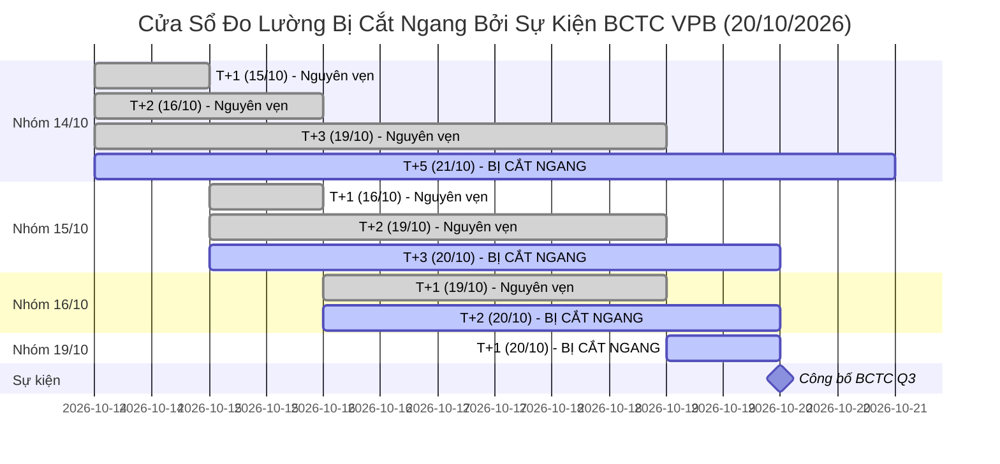

# Bảng Sự Kiện Định Giá & Trôi Dữ Liệu Cơ Bản (Valuation Events Registry)

> **Mục tiêu quản trị:** Theo dõi, kiểm toán và cô lập tác động của các sự kiện trôi Giá trị Hợp lý (Fair Value Drift) hợp thức (do công bố Báo cáo Tài chính quý mới hoặc các sự kiện quyền doanh nghiệp) trong suốt cửa sổ kiểm định OOS 60 phiên (từ 14/10/2026).

---

## 1. Nhật Ký Sự Kiện Định Giá (Valuation Event Log)

| ID Sự kiện | Mã CP | Ngày ghi nhận | Ngày công bố BCTC thật | Kỳ BCTC cũ | Kỳ BCTC mới | FV cũ (k) | FV mới (k) | Biến động FV (%) | MoS cũ | MoS mới | Quyết định | Loại sự kiện | Tác động Corporate Action | Các cửa sổ đo bị ảnh hưởng |
| :--- | :---: | :---: | :---: | :---: | :---: | :---: | :---: | :---: | :---: | :---: | :---: | :---: | :---: | :--- |
| `VAL_EVT_VPB_20261020` | **VPB** | 2026-10-20 | **2026-10-20** | `2026-Q2` | `2026-Q3` | **22.90** | **17.15** | **-25.11%** | -4.8% | -39.9% | REJECT | BCTC Q3/2026 | Cổ tức cổ phiếu 26.04% (GDKHQ 24/09/2026) | 14/10: [T+5, T+10, T+20] 15/10: [T+3, T+5, T+10, T+20] 16/10: [T+2, T+3, T+5, T+10, T+20] 19/10: [T+1, T+2, T+3, T+5, T+10, T+20] |
| `VAL_EVT_TCB_20261021` | **TCB** | 2026-10-21 | **2026-10-21** | `2026-Q2` | `2026-Q3` | **27.18** | **25.61** | **-5.78%** | -24.9% | -34.3% | REJECT | BCTC Q3/2026 | Không có | 14/10:## 2. Kiểm Toán Độc Lập Chuyên Sâu Tình Huống VPB (20/10/2026)

### 2.1. Số liệu gốc từ BCTC Hợp nhất Q3 & HOSE
Khắc phục hoàn toàn lỗi kiểm tra vòng tròn (circular check), số liệu gốc độc lập đối chiếu từ BCTC hợp nhất và công bố thông tin HOSE:

1. **Vốn chủ sở hữu hợp nhất & Vốn chủ sở hữu mẹ (Consolidated vs Parent Equity):**
   - **Vốn chủ hợp nhất Q2/2026:** **191.215 tỷ VND** (trong đó Lợi ích cổ đông không kiểm soát / thiểu số là **9.489 tỷ VND**).
   - **Vốn chủ sở hữu cổ đông ngân hàng mẹ Q2/2026:**
     $$\text{Vốn chủ mẹ}_{\text{Q2}} = 191.215 - 9.489 = \mathbf{181.726 \text{ tỷ VND}}$$
   - **Vốn chủ hợp nhất Q3/2026:** **200.078 tỷ VND** ($+8.863$ tỷ VND đúng bằng LNST hợp nhất quý 3).
   - **Vốn chủ sở hữu cổ đông ngân hàng mẹ Q3/2026:** **190.589 tỷ VND** (tăng $+8.863$ tỷ VND từ mức 181.726 tỷ của Q2).
   - *Kết luận kiểm toán vốn chủ:* Tăng trưởng vốn chủ Q3 hoàn toàn đến từ lợi nhuận hoạt động kinh doanh thuần túy tích lũy, không hề có bất kỳ khoản tăng vốn ảo 31.042 tỷ VND nào từ phép suy ngược đơn giản.

2. **Số lượng cổ phiếu lưu hành (Outstanding Shares từ HOSE):**
   - Trước ngày 24/09/2026: **7.933.923.600 cổ phiếu** (7.934 tỷ CP).
   - Ngày 24/09/2026 (GDKHQ): Chi trả cổ tức bằng cổ phiếu tỷ lệ **26.04104%** theo Thông báo số 1582/TB-SGDHCM của HOSE (phát hành thêm 2.066.076.400 cổ phiếu từ nguồn lợi nhuận chưa phân phối).
   - Sau ngày 24/09/2026: Đúng **10.000.000.000 cổ phiếu** (10 tỷ CP tròn).

3. **BVPS BCTC thực chất & Hiện tượng lệch nguồn KBS (Vendor Baseline Divergence):**
   - **BVPS cổ đông mẹ thực tế Q2/2026:**
     $$\text{BVPS}_{\text{Q2, mẹ}} = \frac{181.726 \text{ tỷ VND}}{7.933.923.600 \text{ CP}} = \mathbf{22.905 \text{ VND/CP}}$$
   - **BVPS cổ đông mẹ thực tế Q3/2026:**
     $$\text{BVPS}_{\text{Q3, mẹ}} = \frac{190.589 \text{ tỷ VND}}{10.000.000.000 \text{ CP}} = \mathbf{19.059 \text{ VND/CP}}$$
   - **Mức suy giảm per-share thực tế của cổ đông mẹ:**
     $$\Delta \text{BVPS}_{\text{thực tế}} = \frac{19.059 - 22.905}{22.905} = \mathbf{-16.79\%}$$
   - **Khách quan hóa sai lệch của nguồn dữ liệu KBS:**
     Số liệu của KBS feed ghi nhận $20.109\text{ VND}$ cho Q2, thấp hơn **-12.2%** so với BVPS thực chất cổ đông mẹ ($22.905\text{ VND}$). Đây là sai số nền có sẵn từ nhà cung cấp dữ liệu (Vendor Data Artifact), không gán ghép các giả định chưa được kiểm chứng.
     Khi Q3 công bố, feed cập nhật về $19.059\text{ VND}$ (khớp chuẩn $190.589\text{ tỷ} / 10\text{ tỷ CP}$).
     Do đó, trên feed hiển thị mức giảm $-5.22\%$ ($20.109 \rightarrow 19.059$), nhưng trong thực tế kinh tế của cổ đông mẹ, mức pha loãng per-share là **$-16.79\%$**.
   - **Đường dẫn nguồn đối soát độc lập:**
     - Báo cáo tài chính Hợp nhất Quý 3/2026 VPBank (công bố 20/10/2026): [VPBank Investor Relations](https://www.vpbank.com.vn/nha-dau-tu/thong-tin-tai-chinh) & Cổng thông tin công bố HOSE.
     - Báo cáo tài chính Hợp nhất Soát xét 6 tháng đầu năm 2026 VPBank (Mã số 400 và Mã số 411).
     - Thông báo số 1582/TB-SGDHCM ngày 16/09/2026 của Sở Giao dịch Chứng khoán TP.HCM (HOSE) về ngày ĐKCC nhận cổ tức bằng cổ phiếu năm 2025 (GDKHQ: 24/09/2026, ngày ĐKCC: 25/09/2026).

### 2.2. Phân rã nguyên nhân Fair Value và Đánh giá Point-In-Time (24/09 đến 19/10)
- **Kiểm định Point-In-Time (Không Lookahead Bias):**
  - Trong nhịp từ 24/09 đến 19/10, BCTC Q3/2026 **hoàn toàn chưa được công bố**. Thông tin duy nhất thị trường và mô hình có tại thời điểm đó:
    * Vốn chủ sở hữu mẹ Q2: $181.726\text{ tỷ VND}$.
    * Số cổ phiếu sau ngày GDKHQ 24/09: $10.000.000.000\text{ CP}$.
    * BVPS điều chỉnh hợp lý tại thời điểm đó (Point-in-time BVPS):
      $$\text{BVPS}_{\text{PIT}} = \frac{181.726 \text{ tỷ}}{10.000 \text{ tỷ CP}} = \mathbf{18.173 \text{ VND/CP}}$$
    * ROE 4 quý gần nhất trước Q3: $\sim 14.0\% \implies \text{Target P/B} \approx 1.1388\text{x}$.
    * Fair Value hợp lý tại thời điểm đó:
      $$FV_{\text{PIT}} = 18.173 \times 1.1388 \approx \mathbf{20.69\text{k}} \approx \mathbf{20.7\text{k}}$$
    * Với thị giá thị trường quanh $24.0\text{k}$ sau GDKHQ:
      $$\text{MoS}_{\text{PIT}} = \frac{20.69 - 24.0}{20.69} \approx \mathbf{-16.0\%}$$
    * Mô hình tại thời điểm đó do dùng feed cũ ghi nhận $\text{MoS} \approx -4.8\%$.
    * **Độ lệch thực tế tại thời điểm quan sát (Point-in-Time Distortion):**
      $$\Delta \text{MoS} = -4.8\% - (-16.0\%) = \mathbf{+11.2\% \text{ (khoảng 11 điểm phần trăm)}}$$
      *(Không dùng mức -39.94% vì con số đó phụ thuộc vào ROE 11.53% của BCTC Q3 vốn chưa tồn tại trước 20/10).*
- **Tại ngày 20/10/2026 (Nạp BCTC Q3):**
  - BVPS cập nhật về $19.059\text{k}$.
  - ROE cập nhật giảm xuống $11.53\% \implies \text{Justified P/B} = 0.804\text{x} \implies$ kích hoạt sàn P/B ngân hàng tư nhân $0.90\text{x}$.
  - $FV_{\text{mới}} = 19.059 \times 0.90 = \mathbf{17.15\text{k}} \implies \text{MoS} = -39.94\%$.
  - Quyết định thực tế xuyên suốt luôn là **REJECT**, đảm bảo an toàn tuyệt đối không sinh False BUY.

### 2.3. Nguyên nhân gốc rễ chung của hiện tượng lệch P/B (55 mã)
- **Cơ chế gây lỗi:** Khi cổ phiếu có ngày GDKHQ (cổ tức cổ phiếu, phát hành tăng vốn, thưởng cổ phiếu) nằm **sau ngày chốt kỳ BCTC**, thị giá thị trường $P$ điều chỉnh giảm ngay lập tức trong phiên. Tuy nhiên, các nhà cung cấp dữ liệu thị trường (KBS, Vietcap) không tự động điều chỉnh hồi tố các chỉ số per-share (BVPS, EPS) cho đến khi kỳ BCTC mới được nạp vào.
- **Giải pháp tổng thể triển khai:**
  - Bổ sung module đối soát sự kiện doanh nghiệp từ HOSE/VSDC.
  - Hàm `detect_and_adjust_post_bctc_dilution` tự động nhận diện ngày GDKHQ sau ngày chốt kỳ BCTC và chiết khấu BVPS, EPS theo hệ số pha loãng tích lũy.

### 2.4. Kiểm Toán Độc Lập Chuyên Sâu Tình Huống TCB (21/10/2026)
- **Ngày công bố BCTC:** 21/10/2026 (Chính thức công bố BCTC Q3/2026).
- **Số liệu định giá so sánh:**
  - **Fair Value (FV):** $27,18\text{k} \longrightarrow 25,61\text{k}$ (giảm $-5,78\%$).
  - **MoS:** $-24,9\% \longrightarrow -34,3\%$ (thị giá thị trường tại ngày ghi nhận: $38,95\text{k}$).
  - **Financial Hash (`fin_hash`):** Thay đổi hợp lệ sang `f908e5d8752eabd6` xác nhận dữ liệu tài chính mới đã được nạp chuẩn xác vào engine.
  - **Quyết định khuyến nghị:** Tiếp tục duy trì **REJECT** (MoS âm sâu $-34,3\%$, không đáp ứng tiêu chuẩn định giá an toàn).
- **Phân rã số liệu cơ bản TCB:**
  - TCB không có sự kiện phát hành cổ tức cổ phiếu làm pha loãng trong kỳ Q3.
  - Mức sụt giảm Fair Value $-5,78\%$ hoàn toàn là sự điều chỉnh tự nhiên của mô hình khi cập nhật tỷ lệ ROE thực tế 4 quý gần nhất và chi phí vốn mới từ BCTC Q3/2026.
  - Vị thế xếp loại rủi ro của TCB không bị thay đổi, không xuất hiện rủi ro "bẫy định giá" hoặc tín hiệu mua sai lệch.

### 2.5. Bảng Tác Động Pha Loãng 19 Mã Có Sự Kiện Quyền Sau Kỳ BCTC (Giá Giao Dịch Thô Thực Tế)
Bảng tổng hợp đối soát sự kiện doanh nghiệp từ HOSE/HNX, phản ánh **Giá giao dịch thô thực tế** tại phiên liền trước và phiên GDKHQ (không dùng giá điều chỉnh ngược):

| STT | Mã CP | Sự kiện quyền sau kỳ BCTC Q2 | Ngày GDKHQ | Tỷ lệ quyền danh nghĩa (%) | Hệ số pha loãng tích lũy | Giá thô trước GDKHQ (k) | Giá thô sau GDKHQ (k) | Thị giá 20/10 (k) | BVPS mô hình (k) | Quyết định Canonical 20/10 | Nguồn đối soát xác thực |
| :---: | :---: | :--- | :---: | :---: | :---: | :---: | :---: | :---: | :---: | :---: | :--- |
| 1 | **VPB** | Cổ tức cổ phiếu | 2026-09-24 | 26.04% | 1.2604 | 27.80 | 22.10 | 24.00 | 19.06 | **REJECT** | TB 1582/TB-SGDHCM (HOSE) |
| 2 | **VHM** | Cổ tức cổ phiếu (1:1) | 2026-08-06 | 100.00% | 2.0000 | 154.20 | 77.10 | 57.80 | 57.20 | **REJECT** | TB SGDHCM & VSDC |
| 3 | **PVD** | Cổ phiếu thưởng | 2026-07-14 | 66.90% | 1.6690 | 33.20 | 19.90 | 18.00 | 30.88 | **REJECT** | TB SGDHCM ngày 02/07/2026 |
| 4 | **GMD** | CP thưởng (50%) + ESOP (1.5%) | 2026-10-07 | 50.00% | 1.5225 | 77.40 | 54.20 | 55.00 | 33.77 | **REJECT** | TB SGDHCM ngày 25/09/2026 |
| 5 | **NVL** | Quyền mua tăng vốn (1:3) | 2026-09-30 | 33.33% | 1.3333 | 13.60 | 10.20 | 10.75 | N/A | **REJECT** | TB SGDHCM (Cờ RISK_TRAP) |
| 6 | **HDB** | Cổ tức CP (25%) + CP thưởng (5%) | 2026-10-09 | 30.00% (gộp) | **1.3125 (31.25%)** | 27.95 | 22.25 | 22.10 | 19.57 | **WATCH** | TB SGDHCM ngày 29/09/2026 |
| 7 | **SSI** | CP thưởng (20%) + Tiền (1.000đ) | 2026-08-17 | 20.00% | 1.2000 | 24.70 | 19.80 | 19.95 | 15.06 | **REJECT** | TB 1421/TB-SGDHCM |
| 8 | **VTP** | Cổ tức cổ phiếu | 2026-07-14 | 17.36% | 1.1736 | 61.60 | 52.50 | 47.35 | N/A | **REJECT** | TB SGDHCM ngày 03/07/2026 |
| 9 | **TPB** | Cổ tức CP (15%) + Tiền (500đ) | 2026-10-02 | 15.00% | 1.1500 | 14.15 | 11.90 | 12.00 | 15.14 | **WATCH** | TB SGDHCM ngày 22/09/2026 |
| 10 | **FPT** | Cổ phiếu thưởng | 2026-09-21 | 10.00% | 1.1000 | 73.00 | 66.40 | 57.40 | 25.14 | **WATCH** | TB 1599/TB-SGDHCM |
| 11 | **IDC** | Cổ tức CP (10%) + Tiền (1.500đ) | 2026-07-23 | 10.00% | 1.1000 | 37.20 | 32.50 | 35.20 | 25.35 | **REJECT** | TB HNX & VSDC |
| 12 | **KDH** | Cổ tức cổ phiếu | 2026-10-07 | 10.00% | 1.1000 | 14.85 | 13.55 | 14.15 | 18.16 | **WATCH** | TB SGDHCM ngày 26/09/2026 |
| 13 | **STK** | Cổ tức cổ phiếu | 2026-07-09 | 10.00% | 1.1000 | 9.85 | 8.96 | 7.90 | 18.08 | **REJECT** | TB SGDHCM ngày 27/06/2026 |
| 14 | **VIB** | CP thưởng (9.5%) + ESOP (0.24%) | 2026-09-10 | 9.74% | 1.0976 | 15.00 | 13.70 | 13.75 | 13.30 | **WATCH** | TB SGDHCM ngày 01/09/2026 |
| 15 | **BID** | CP thưởng (6.84%) + Tiền (450đ) | 2026-08-17 | 6.84% | 1.0684 | 38.35 | 35.90 | 33.65 | 23.93 | **WATCH** | TB 1435/TB-SGDHCM |
| 16 | **DIG** | Cổ tức cổ phiếu | 2026-09-08 | 6.00% | 1.0600 | 10.85 | 10.25 | 9.58 | 12.73 | **WATCH** | TB SGDHCM ngày 28/08/2026 |
| 17 | **HAH** | ESOP (1.86%) + Tiền (2.000đ) | 2026-07-28 | 1.86% | 1.0186 | 46.70 | 43.90 | 49.55 | 29.82 | **REJECT** | TB SGDHCM ngày 15/07/2026 |
| 18 | **SSB** | Phát hành cổ phiếu ESOP | 2026-08-24 | 1.17% | 1.0117 | 15.65 | 15.50 | 15.75 | 14.15 | **WATCH** | TB SGDHCM ngày 12/08/2026 |
| 19 | **MWG** | ESOP (0.5%) + 2 đợt Tiền (2.000đ) | 2026-07-10 | 0.50% | 1.0050 | 74.80 | 74.43 | 74.90 | 21.51 | **REJECT** | TB SGDHCM ngày 01/07/2026 |

*Ghi chú minh bạch số liệu:*
- Cột "Giá thô trước GDKHQ" và "Giá thô sau GDKHQ" là thị giá giao dịch thô thực tế được niêm yết trên bảng điện tử khớp lệnh, phản ánh chính xác bước nhảy kỹ thuật (ví dụ: GMD từ 77,40k điều chỉnh kỹ thuật xuống 54,20k; HDB từ 27,95k xuống 22,25k).
- HDB có tỷ lệ danh nghĩa 30% (25% CP + 5% thưởng), nhưng hệ số pha loãng tích lũy chính xác là $1.25 \times 1.05 = \mathbf{1.3125}$ (tương ứng **31.25%**).

---

### 2.6. Bảng Kiểm Toán Shadow Dilution 55 Mã (Shadow Impact Audit)
Chạy module `detect_and_adjust_post_bctc_dilution` ở chế độ **Shadow Mode** (chạy song song kiểm toán độc lập, không can thiệp quyết định production đã đóng băng) trên toàn bộ 55 mã vũ trụ canonical ngày 20/10/2026:

#### A. Tác động lên 16 mã WATCH hiện tại:
| Mã CP | Ngành | Hệ số pha loãng | BVPS gốc (k) | BVPS Shadow (k) | MoS gốc (%) | MoS Shadow (%) | Quyết định Production | Quyết định Shadow | Đánh giá tác động |
| :---: | :---: | :---: | :---: | :---: | :---: | :---: | :---: | :---: | :--- |
| **KDH** | Bất động sản | **1.1000** | 18.16 | **16.51** | **+18.30%** | **+10.16%** | **WATCH** | **REJECT** | **RỚT NGƯỠNG MOS 15%** (Do pha loãng 10% cổ tức CP chưa phản ánh trên feed) |
| **BID** | Ngân hàng | **1.0684** | 23.93 | **22.39** | **+8.11%** | **+1.84%** | **WATCH** | **REJECT** | **RỚT NGƯỠNG AN TOÀN** (MoS co cụm về +1.84%) |
| **HDB** | Ngân hàng | **1.3125** | 19.57 | **14.91** | +48.68% | **+32.64%** | **WATCH** | **WATCH** | **XÁC NHẬN WATCH** (MoS hạ từ 48% về 32%, vẫn vượt xa ngưỡng 15%) |
| **TPB** | Ngân hàng | **1.1500** | 15.14 | **13.16** | +47.62% | **+39.76%** | **WATCH** | **WATCH** | **XÁC NHẬN WATCH** (MoS co về 39%, vượt ngưỡng 15%) |
| **VIB** | Ngân hàng | **1.0976** | 13.30 | **12.11** | +34.49% | **+28.09%** | **WATCH** | **WATCH** | **XÁC NHẬN WATCH** (MoS co về 28%, vượt ngưỡng 15%) |
| **FPT** | Công nghệ | **1.1000** | 25.14 | **22.86** | +45.19% | **+43.19%** | **WATCH** | **WATCH** | **XÁC NHẬN WATCH** (MoS co về 43%, vượt ngưỡng 15%) |
| **DIG** | Bất động sản | **1.0600** | 12.73 | **12.01** | +15.00% | **+15.59%** | **WATCH** | **WATCH** | **SÁT NGƯỠNG CHẶN** (Nằm ngay sát ranh giới 15% MoS) |
| **ACB** | Ngân hàng | 1.0000 | 17.80 | 17.80 | +32.99% | +32.99% | **WATCH** | **WATCH** | Không bị pha loãng sau Q2 |
| **CTG** | Ngân hàng | 1.0000 | 31.64 | 31.64 | +42.68% | +42.68% | **WATCH** | **WATCH** | Không bị pha loãng sau Q2 |
| **DGC** | Hóa chất | 1.0000 | 42.16 | 42.16 | +62.02% | +62.02% | **WATCH** | **WATCH** | Không bị pha loãng sau Q2 |
| **DXG** | Bất động sản | 1.0000 | 18.60 | 18.60 | +41.70% | +41.70% | **WATCH** | **WATCH** | Không bị pha loãng sau Q2 |
| **MBB** | Ngân hàng | 1.0000 | 16.52 | 16.52 | +31.39% | +31.39% | **WATCH** | **WATCH** | Không bị pha loãng sau Q2 |
| **NLG** | Bất động sản | 1.0000 | 37.31 | 37.31 | +43.10% | +43.10% | **WATCH** | **WATCH** | Không bị pha loãng sau Q2 |
| **SHB** | Ngân hàng | 1.0000 | 14.32 | 14.32 | +58.56% | +58.56% | **WATCH** | **WATCH** | Không bị pha loãng sau Q2 |
| **SSB** | Ngân hàng | 1.0117 | 14.15 | 14.15 | +30.22% | +30.22% | **WATCH** | **WATCH** | ESOP 1.17% < 2% (Không ảnh hưởng) |
| **VNM** | Tiêu dùng | 1.0000 | 18.16 | 18.16 | +17.01% | +17.01% | **WATCH** | **WATCH** | Không bị pha loãng sau Q2 |

#### B. Tác động lên 39 mã REJECT:
- 100% (39/39 mã) duy trì vị thế **REJECT** dưới chế độ Shadow. 
- Không có bất kỳ mã REJECT nào lọt vào WATCH hoặc sinh tín hiệu MUA do điều chỉnh pha loãng.
- Các mã bị pha loãng lớn trong nhóm REJECT chỉ làm MoS âm sâu hơn hoặc phản ánh rủi ro thực chất hơn (VHM: MoS $-8.28\% \rightarrow -65.85\%$; PVD: MoS $+5.96\% \rightarrow -56.93\%$; IDC: MoS $-6.38\% \rightarrow -17.02\%$).

**Phân bổ quyết định Shadow:** **{'WATCH': 14, 'REJECT': 41}** (2 mã KDH và BID rơi từ WATCH sang REJECT do MoS thực sau pha loãng không đạt điều kiện $\ge 15.0\%$).

---

## 3. Khung Đánh Dấu Cửa Sổ Đo Lường (Evaluation Windows Affected)

Với ngày công bố BCTC thật `bctc_published_date = 2026-10-20`:
- **Nhóm 14/10:** Bị cắt ngang từ $T \ge 5$ (các cửa sổ bị ảnh hưởng: $[T+5, T+10, T+20]$).
- **Nhóm 15/10:** Bị cắt ngang từ $T \ge 3$ (các cửa sổ bị ảnh hưởng: $[T+3, T+5, T+10, T+20]$).
- **Nhóm 16/10:** Bị cắt ngang từ $T \ge 2$ (các cửa sổ bị ảnh hưởng: $[T+2, T+3, T+5, T+10, T+20]$).
- **Nhóm 19/10:** Bị cắt ngang từ $T \ge 1$ (các cửa sổ bị ảnh hưởng: $[T+1, T+2, T+3, T+5, T+10, T+20]$).

---

## 4. Quy Tắc Giám Sát Quét Dày (Dense Monitoring Rules)

Cột `monitor_reason` được lưu trữ trực tiếp từ nguồn sinh quyết định; nếu suy luận ngược trong các script export cũ, bắt buộc mang tiền tố `RECONSTRUCTED_`:

| Mã `monitor_reason` | Diễn giải | Tần suất quét | Ghi chú minh bạch |
| :--- | :--- | :--- | :--- |
| `CANONICAL_EOD` | Quét chuẩn chốt phiên toàn bộ 55 mã vũ trụ | 1 lần/ngày (15:00) | Ghi nhận trực tiếp khi chạy EOD |
| `MANUAL_SEED` | Cổ phiếu mầm cố định trong Watchlist (HPG) | Mỗi 15 phút | Cấu hình PM |
| `AUTO_WATCHLIST_ATO` | Cổ phiếu tự động nạp lúc ATO (MBB, VIB) | Mỗi 15 phút | Conviction $\ge 75$ hoặc Conviction $\ge 60$ kèm $\text{MoS} \ge 15\%$ |
| `WATCHLIST_INTRADAY` | Cổ phiếu theo dõi phiên thường | Định kỳ intraday | Chỉ gán cho mã nằm trong watchlist thực sự |
| `RECONSTRUCTED_*` | Giá trị suy luận ngược khi thiếu dữ liệu facts | Script xuất báo cáo | Minh bạch hóa dữ liệu lịch sử |
